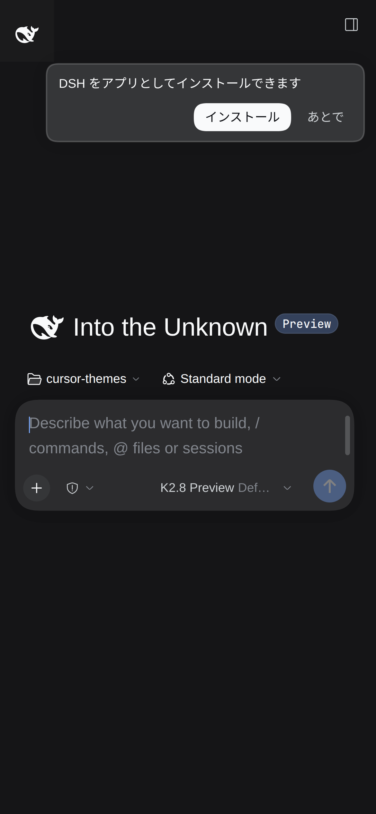
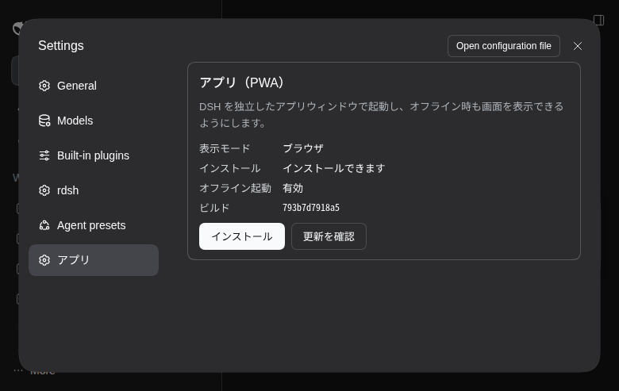
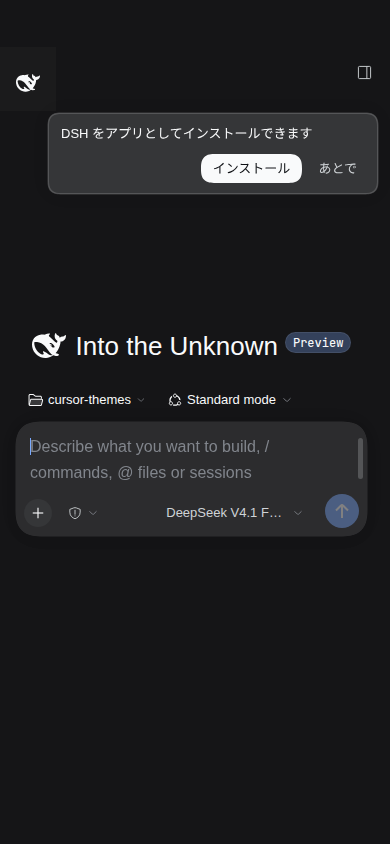

# rdsh-pwa — DSH PWA + モバイルUX

DSH Web GUI を「インストールできるアプリ」にし、スマホ幅の操作感までまとめて改善する
**統合 DSH プラグイン**です。PWA 本体（マニフェスト・サービスワーカー・インストール導線）と
`rdsh-mobile-ux`（ドロワー・設定・通知・入力・ターミナル・モデル選択）が1パッケージで入ります。
インストール済み DSH の `dist` は書き換えません。

- ホスト側: `/manifest.webmanifest` `/sw.js` `/pwa/*.png` を配信し、`index.html` に iOS/Android 用の
  メタ情報と `viewport-fit=cover` を注入します。
- クライアント側: サービスワーカーの登録、`beforeinstallprompt` の捕捉、サイドバー／設定／スマホ用の
  インストール UI、更新バナー、オフライン表示、スタンドアロン時のセーフエリア処理を行います。

## できること

| 機能 | 内容 |
| --- | --- |
| インストール | Chrome / Edge / Android で「アプリをインストール」。192/512px + maskable アイコン、`display: standalone`、`launch_handler: focus-existing`（アイコン再タップで既存ウィンドウを前面に） |
| オフライン起動 | アプリシェルをキャッシュし、圏外でも画面が出る（`/api` は絶対にキャッシュしない）。接続が戻ると自動で通常動作に戻る |
| ホーム画面 | iOS 用 `apple-touch-icon` / `apple-mobile-web-app-status-bar-style`、`format-detection: telephone=no`。`apple-mobile-web-app-capable` / `apple-mobile-web-app-title` / `application-name` は**付けない**（iOS 26 でレガシーな view frame になり、下にステータスバー分の未描画帯が出るため）。standalone は manifest の `display` で指定 |
| セーフエリア | スタンドアロン起動時だけ `env(safe-area-inset-*)` を `#root` の padding に反映。ノッチ・ホームインジケータと重ならない |
| キーボード | `interactive-widget=resizes-content` で、ソフトキーボード表示時に入力欄が隠れない |
| インストール導線 | サイドバー下部のアイコン、スマホ用カード（「あとで」で30日スヌーズ）、設定 →「アプリ」 |
| 更新通知 | 新しいビルドのサービスワーカーが待機したら「新しいバージョンがあります → 再読み込み」。勝手にリロードはしない（実行中のセッションを壊さない） |
| オフライン表示 | 上部に「オフライン — 再接続を待っています」 |
| Web Push | `dsh-notify-push` の通知をそのまま維持（下記「通知との共存」） |

## 見た目

スマホ幅ではヘッダー下にインストールカード（「あとで」で30日スヌーズ）、サイドバー下部には
インストールアイコンが出ます。設定 →「アプリ」で状態と操作をまとめて確認できます。





## スマホ向けUX（mobile-ux）

[`mobile-ux/`](mobile-ux/README.md) は、インストールしたアプリの**使い勝手**を担当するプラグインで、
このパッケージに**同梱**されています。セッション一覧をオーバーレイのドロワーにし、Settings を
スマホ幅に積み、タップ／長押しを分け、PWA の通知設定と「スマホでは使えない操作」の非表示リストを
提供します。追加インストールは不要です。

実行中セッションの表示は3案のモックアップから選べます（既定は outline）:
[mockups/animation-aurora.html](mockups/animation-aurora.html) /
[mockups/animation-breathing.html](mockups/animation-breathing.html) /
[mockups/animation-outline.html](mockups/animation-outline.html)

## インストール

**`rdsh-pwa` 1つ**で PWA とスマホUX（`rdsh-mobile-ux`）がまとめて入ります。プロファイルの
`package.json` に依存と bundle を追加し、パッケージを入れて DSH を再起動します。

### GitHub Releases の tarball から

```json
{
  "dependencies": {
    "rdsh-pwa": "https://github.com/kuraneko1/DSH-PWA/releases/download/v0.1.0/rdsh-pwa-0.1.0.tgz"
  },
  "dsh": {
    "profile": {
      "bundles": ["...", "rdsh-pwa"]
    }
  }
}
```

```sh
npm install        # プロファイル内。pnpm でも可
# DSH を再起動（環境に合わせて。例: systemctl --user restart dsh-web.service）
```

### npm から

npm に公開した場合はバージョン指定でも入ります。

```json
"rdsh-pwa": "^0.1.0"
```

```sh
npm install rdsh-pwa
# DSH を再起動
```

配布方法は GitHub Releases / npm のどちらでも構いません。tarball を使う場合は、リリースに
`rdsh-pwa-0.1.0.tgz` を添付してください（`npm pack` で生成できます）。

外すときは依存と bundle から `rdsh-pwa` を消して再起動するだけです（配信ルートとメタ情報が消え、
サービスワーカーは `navigator.serviceWorker` の登録解除で消えます）。

### このリポジトリを直接使う（開発用）

```json
"rdsh-pwa": "link:/path/to/DSH-PWA"
```

```sh
ln -sfn /path/to/DSH-PWA ~/.dsh/profiles/<profile>/node_modules/rdsh-pwa
systemctl --user restart dsh-web.service
```

### 設定（任意）

`cordis.patch.yml` の既存行に `config` を足すと上書きできます。既定値は DSH のダークUIに合わせています。
スマホUXの設定（`runningAnimation` / `hideLabels` / `showHiddenControls`）は
[`mobile-ux/README.md`](mobile-ux/README.md) を参照してください。

```yaml
- id: rdsh-pwa
  name: "rdsh-pwa"
  config:
    name: "DeepSeek Harness"
    shortName: "DSH"
    display: "standalone"        # standalone | minimal-ui | fullscreen | browser
    themeColor: "#151517"
    backgroundColor: "#151517"
    appleStatusBarStyle: "black-translucent"
    enableServiceWorker: true
    navigationTimeoutMs: 1500     # これを超えたらキャッシュのシェルを出す
```

## 依存関係

**`rdsh-pwa` 1つで完結**します。他の `rdsh-*` プラグイン（rdsh-settings / rdsh-mobile-ui /
rdsh-answer-guard など）は不要です。

| 依存 | 必須か | 内容 |
| --- | --- | --- |
| DSH 本体（`@deepseek-ai/dsh-*`） | 必須 | サイドバー、設定、モデル選択、Goal、Todo、ジョブの各UI。上流のクラス名は CSS Modules のハッシュなので、このプラグインは**構造（`data-row-key` / `aria-label` / `role`）から `data-rdsh-*` フックを付けて** CSS はフックだけを見ます。上流が変わればフックが付かず、標準のレイアウトのまま（fail closed） |
| `rdsh-mobile-ux` | 同梱 | このパッケージの `dependencies` に `file:./mobile-ux` として入っており、`cordis.patch.yml` が両方を登録します。単体インストールは不要 |
| `dsh-notify-push` | 任意 | 通知（Web Push）を使う場合だけ。無い場合「通知サーバーがありません」と表示され、他の機能は動きます |
| `react` | DSH が提供 | クライアント側は `require("react")` のみ。ホスト側は Node 標準モジュールのみ |

クライアント側が読むグローバルは自分自身のもの（`__RDSH_PWA__` / `__RDSH_PWA_SETTINGS_SECTION__` /
`__RDSH_MOBILE_UX__`）だけで、いずれも `typeof` で存在確認してから使います。

## 通知（dsh-notify-push）との共存

ブラウザは 1 つのスコープに 1 つのサービスワーカーしか置けません。`dsh-notify-push` は
`/push/sw.js` を scope `/` で登録するため、そのままでは**ページを読み込むたびに 2 つのワーカーが
互いを置き換え**、負けた側が `waiting` のまま残ります（オフラインキャッシュが効かず、更新通知も
誤発火します）。

このプラグインは `navigator.serviceWorker.register` を薄くラップし、`/push/sw.js` への登録だけを
`/sw.js` に向けます。`/sw.js` 側が `push` / `notificationclick` を実装しているので、通知はそのまま
動き、ルートスコープのワーカーは常に 1 つになります。ラップは該当 URL 以外には影響せず、
プラグイン破棄時に元へ戻します。

`dsh-notify-push` が見つからない構成でも単体で動きます。

## 検証

```sh
npm test                          # ホスト側の単体テスト（ブラウザ不要）
BASE_URL=http://127.0.0.1:3099 node tests/e2e.mjs   # 実ブラウザで end-to-end
npm pack                          # 配布用 tarball（リリースに添付する）
```

`rdsh-pwa-0.1.0.tgz` を GitHub Releases に添付してあります。`npm install <そのURL>` で
`rdsh-pwa` と `rdsh-mobile-ux` の両方が入ることを確認済みです。

`tests/e2e.mjs` はヘッドレス Chrome を自前で起動し、マニフェスト・メタ情報・サービスワーカー制御・
インストール導線・**オフライン再読み込み**まで確認します。

更新フロー（新しい `sw.js` を配信 → バナー → 再読み込みで新ビルド）は、`sw.js` に 1 行足して
サーバーを再起動し、ページを再読み込みすると手動で確認できます。

## 仕組み

```
ブラウザ ── GET / ──────────────► index.html（ホストがメタ情報と viewport を注入）
         ── GET /manifest.webmanifest ─► ホスト（アイコン・色・launch_handler）
         ── register('/sw.js') ──► SW（shell を network-first、assets を cache-first）
         ── GET /api/* ──────────► SW は関与しない（常にサーバー）
```

- `sw.js` のビルドハッシュは**ファイル内容の SHA-256**。ホストが起動時に先頭へ
  `self.__RDSH_PWA_BUILD__` として埋め込むので、`sw.js` を編集した時だけキャッシュ名が変わり、
  更新バナーが出ます。
- シェルは `network-first`（既定 1.5 秒）。オフラインやサーバー再起動中はキャッシュ、
  キャッシュも無ければ組み込みのオフラインページ。`/api` `/hmr` `/terminal` と非 GET は素通し。
- キャッシュは 1 世代だけ保持し、静的アセットは 250 件で古い順に捨てます。

## アイコン

`assets/` は DSH Web フロントエンドの `favicon-dark.svg`（MIT）から生成しています。
差し替えるときは同じサイズで `icon-192/512`、`icon-maskable-192/512`（内側 80% に収める）、
`apple-touch-icon`（180、透過なし）、`badge-96`（白シルエット）を置き換えてください。

## 既知の制限

- オフラインでできるのは「画面を出す」ところまで。セッション一覧や会話はサーバーが持つので、
  オフライン中は空の画面と切断表示になります（再接続で復帰）。
- HTTPS か localhost でのみサービスワーカーが動きます（Tailscale の `https://…ts.net` は可）。
- DSH 本体の更新では `sw.js` のバイト列が変わらないため更新バナーは出ません。シェルは毎回
  network-first なので、本体更新は再読み込みだけで反映されます。

## iOS 26 の下余白（47px / 62px）

iOS 26 のホーム画面 PWA は、`apple-mobile-web-app-capable` などの Apple 専用メタがあると
レガシーな view frame を使い、WebView をステータスバー分だけ短く作って下に未描画の帯を残す
（[WebKit 301994](https://bugs.webkit.org/show_bug.cgi?id=301994)）。この帯は DOM の外なので
CSS では消せない。`toduka-drive` の構成（manifest + `mobile-web-app-capable` +
`black-translucent` + `apple-touch-icon`、Apple の capable/title なし）に合わせて、
DSH も Apple 専用メタを外している。それでも残る場合の確認用に、PWA マークアップを外した
`/launch` を用意している（ホスト側の変更なので再起動で有効）。

`rdsh-mobile-ux` は `navigator.standalone` かつ `screen.height - innerHeight > 8` のとき
`data-rdsh-native-gap` を付け、内側の下セーフエリアを 0 にして余白を最小化する。

**2重スクロール**は別原因だった。iOS 26 の standalone では `100%` がレイアウトビューポート
（844px）を指し、実際の WebView は 797px しかない。その47pxの差だけ body がはみ出し、
ページがパンできる。スマホ幅では `html, body` を `100dvh`、`body` を1行グリッド、
`#root` を `100%` にして、本文（`scrollBody`）だけがスクロールするようにしている。
47pxの未描画帯そのものはネイティブで、CSSでは消えない。
