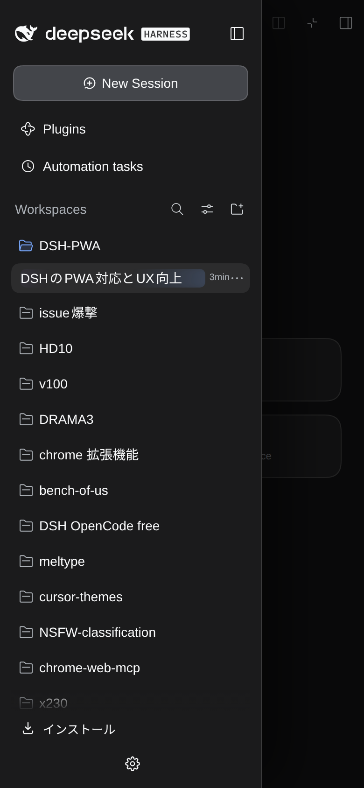
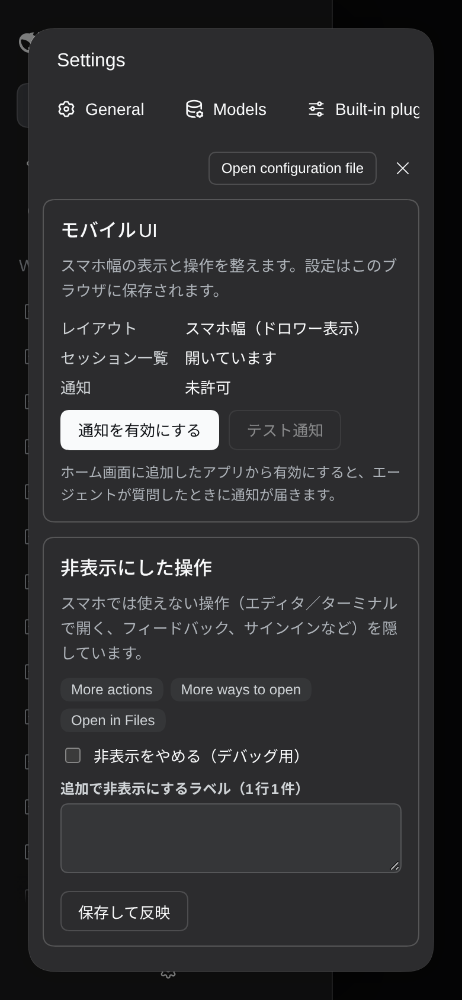

# rdsh-mobile-ux

DSH Web UI のスマホ幅（とインストールした PWA）向けの操作感をまとめて直すプラグインです。
`rdsh-pwa` が「アプリとして入る」ところまでを担当し、こちらは「入ったあとが使いやすいか」を担当します。




## 変わること

| # | 内容 |
| --- | --- |
| 1 | セッション一覧が**オーバーレイのドロワー**になる。チャットは圧縮されず全幅のまま |
| 3 | ドロワーは左からスライド（0.24s、`prefers-reduced-motion` でも短い移動のみ）。背景タップで閉じる |
| 2 | Settings を **rdsh の設定と同じ形式**に。ナビを上段の横スクロール、本文を全幅に積む |
| 4 | セッション行は**タップで開く**。長押しのドラッグはそのまま（タップがドラッグに食われた場合だけ click を1回補完） |
| 5 | セッションを開いたらドロワーを閉じ、**入力欄へフォーカスしない** |
| 6 | 設定 →「モバイル」から**通知の有効化・テスト送信**。PWA のインストール後に使う |
| 7 | 上部タイトルをタップすると**フルネームのポップオーバー** |
| 8 | スマホで使えない操作を**非表示リスト**で隠す（設定画面で一覧・解除・追加ができる） |
| 9 | 右パネルは常に全画面。中の表はパネル内でスクロールし、画面ごと横スクロールしない |
| 10 | スクロール端の弾力（オーバースクロール）を止める |
| 11 | セッション行のラベル幅を拡張（アーカイブ／ピンのアイコンと空のステータス枠を畳む） |
| 12 | セッション画面の左上に**ハンバーガー（三本線）ボタン**を常時表示（タップでセッション一覧）。ドロワー内の DeepSeek HARNESS ロゴはそのまま残す。右上の「Open in Files」「More actions」は非表示 |
| 13 | アカウントメニューの Feedback / Sign in を隠し、**More を歯車（設定）**に。タップで Settings が直接開く |
| 14 | 変更ファイル一覧（`Edited N files`）の行間を詰める |
| 15 | 「セッションIDをコピー」の重複を1つに（rdsh の日本語版を残す） |
| 16 | 実行中の表示は既定で **Rounded ring sweep**（`runningAnimation: "outline"`）。`mockups/animation-outline.html` の B / conic mask を移植し、**セッション行全体**を囲む。iOS Safari はマスクの2層ショートハンドを誤解釈して輪が消えるため、`mask-image` / `mask-clip` / `mask-composite` のロングハンド（`-webkit-mask-composite: xor`）で描画。aurora / breathing / none も選択可 |
| 17 | 入力欄の下の統計（ターン数／tok/s／キャッシュヒット／コンテキスト%）を**アイコン付きで**残したまま、セーフエリアに重ねて入力欄を最下部へ寄せる。入力欄の左右余白は標準の16pxのまま |
| 18 | Enter は既定で**改行**（送信は送信ボタン）。設定 →「入力」で送信に切替。iOS のソフトキーボード（keyCode 229）でも改行できる |
| 19 | 「＋」は**OS標準のファイル/画像ピッカーを直接開く**（受け付けは空にして写真とファイルの両方を選択可）。コマンドは `/` から。押してもキーボードは出ない |
| 20 | 画像・ファイルは入力欄への**貼り付け**でも添付できる（アプリ標準の paste 経路） |
| 21 | 設定 →「モバイル」→「スクロール」で、最後にスクロールした要素と現在スクロール可能な要素を確認できる（devtools不要） |
| 22 | 設定 →「モバイル」→「画面の高さ」で `screen.height` / `innerHeight` / 差分 / セーフエリアを確認できる（iOSのPWA空白の切り分け用） |
| 23 | 右サイドバーのメニューが開いている間は、浮いているハンバーガー（セッション一覧）を隠す。閉じると戻る |
| 24 | 本文のセッション余白を**16px**、メッセージ列の幅を**349px**（中央寄せ）に戻す。入力欄は標準の16pxのまま |
| 25 | 自分のクエリのバブルを少し大きく: 最大幅70.2%→**78%**（パディングは変更しない。返信側も変更しない） |
| 26 | 変更ファイルカードの上下を詰める: ファイル行のパディング7px→**4px**、ヘッダー8px→**6px** |
| 27 | 2重スクロール対策: スマホ幅では `100dvh` の1行グリッドにし、本文だけスクロール。詳細は [docs/ISSUES.md](../docs/ISSUES.md) |

## インストール

このプラグインは **`rdsh-pwa` に同梱**されています。単体で入れる必要はありません。
[`../README.md`](../README.md) のインストール手順に従って `rdsh-pwa` を入れてください。

```json
{
  "dependencies": { "rdsh-pwa": "https://github.com/kuraneko1/DSH-PWA/releases/download/v0.1.0/rdsh-pwa-0.1.0.tgz" },
  "dsh": { "profile": { "bundles": ["...", "rdsh-pwa"] } }
}
```

開発中にこのディレクトリだけをリンクする場合:

```json
"rdsh-mobile-ux": "link:/path/to/DSH-PWA/mobile-ux"
```

## 設定

`cordis.patch.yml` で上書きできます。

```yaml
- id: rdsh-mobile-ux
  name: "rdsh-mobile-ux"
  config:
    runningAnimation: "outline"  # outline（既定・ring sweep） | aurora | breathing | none
    hideLabels: ["Open in Files", "More actions"]  # 追加で隠すラベル
    showHiddenControls: false    # true で非表示を全部やめる（デバッグ）
```

ブラウザ側の設定（追加ラベル・非表示の一時解除）は localStorage に保存されます。

## 通知の設定（項目6）

インストールした PWA で、エージェントが質問したときに通知を受け取る手順です。

1. **HTTPS で開く**（Tailscale の `https://…ts.net:8444` など）。`http://` では Service Worker も通知も動きません
2. Chrome のメニュー →「アプリをインストール」（またはサイドバーのインストールアイコン）でホーム画面に追加
3. **インストールしたアプリ**を開き、左上の三点 → 歯車（設定）→「モバイル」
4. 「通知を有効にする」→ 許可 → 「テスト通知」で確認
5. 以後、エージェントが `ask_user_question` を出すと通知が届きます。通知をタップすると該当セッションが開きます

Android の Chrome は通知の許可をアプリ単位で持ちます。ブラウザ側で許可済みでも、インストールしたアプリで
一度「通知を有効にする」を押してください（購読はアプリの Service Worker に紐づきます）。
iOS は 16.4 以降のホーム画面アプリのみ Web Push に対応します。

通知が来ないときは、設定 →「モバイル」の「通知」欄が **有効（購読済み）** か、
`dsh-notify-push` がプロファイルに入っているか（`/api/push/vapid` が 200 を返すか）を確認してください。

## 仕組み

上流のクラス名は CSS Modules のハッシュでリリースごとに変わります。このプラグインはハッシュを直接
指定せず、`data-row-key` / `data-slot` / `aria-label` などの**構造**から `data-rdsh-*` フックを付け、
CSS はフックだけを見ます。名前が変わればフックが付かず、元のレイアウトのまま（fail closed）です。

`decorate()` は `MutationObserver` + `requestAnimationFrame` で間引き、重い処理（スクロール領域の検出など）
は約1秒に1回だけ走らせます。

## 既知の制限

- 右パネルの「分割表示」はスマホでは使いません（開くと全画面へ寄せます）。
- セッション行のアーカイブ／ピンは行からは隠れます。同じ操作は行の「…」メニューから行えます。
- ドロワーの幅は 280px 固定（最大 86vw）です。
- ハンバーガーは「ドロワーが閉じているとき」常に表示します（右パネルの開閉に依存しません）。
  ドロワー内のブランド表記は変更しません。
| 28 | モデル名が省略されても、reasoning effort（Max / High など）は常に表示する（名前に `flex:1`、effort に `flex:0 0 auto`） |
| 29 | 左上ハンバーガーの右上に通知バッジ: 回答終了未読 + 質問/承認待ちをセッション単位で集計し、赤いバブルに最大 **99+** で表示 |
| 30 | 入力欄の**自動フォーカスを廃止**。スマホではコンポーザのテキストボックスをタップしたときだけフォーカスし、セッション開閉・ツールバー・空カード・ファイルピッカー戻りのフォーカスは抑止 |
| 28 | 画像プレビュー: 閉じる／トリミングの操作を**セーフエリアの下**（`safe-area-inset-top + 12px`）へ。画像は残りの高さに縮尺。背景をさらに暗く（0.96） |
| 29 | 画像プレビューは**下スワイプで閉じる**（移動量に応じて画像が下がりフェード、90px超で閉じる） |
| 30 | 画像プレビューに**簡易トリミング**。左上のクロップボタン → ドラッグ／四隅リサイズ／3分割グリッド → 保存で共有シートまたはPNGダウンロード |
| 31 | セッションの3点メニューに**「色枠」**（アイコン付き）。6色＋枠を外す。色はセッションごとに保存し、行を2pxの色枠で囲む |
| 32 | セッション行の**長押しは並べ替えだけ**。タイトルのダブルクリックリネームと長押しコンテキストメニューをスマホでは無効化（リネームは3点メニューから） |
| 33 | 上部タイトルのフルネームポップオーバーを**不透明**（`#2a2a2e`）にして読みやすく |
| 34 | チャット画面の**左端から右スワイプ**でセッションメニューを開く（36px以内から64px以上、縦スクロールとは分離） |
| 35 | テキストボックスの**自動フォーカスを全廃**。セッションを開く／ツールバー／検索／リネーム／設定など、プログラムから当てたフォーカスは遅延blur。**直接タップした入力欄だけ**フォーカス |
| 36 | 画像プレビューの検出を**英語の aria-label 依存から構造判定**へ変更（`role="dialog"` + `_stage_` + `img`、設定モーダルは除外）。さらに `decorateFast` でライトボックス生成と同時に装飾するため、**日本語UIのスマホでも**セーフエリア・暗背景・下スワイプ・クロップが確実に付く |
| 37 | 画像プレビューの下端をセーフエリア内に収める。右パネル（プレビュー）は下端に `safe-area-inset-bottom + ネイティブギャップ(47〜62px)` を確保し、上端は二重のセーフエリアとアプリヘッダー分を除去 |
| 38 | トリミングは**初期状態で画像全体**（4つのハンドルが四隅）。**左/右90度回転**ボタンを追加し、回転後も全体選択から編集できる |
| 39 | 実行中セッションのリングを**マスク合成なしのグラデーションボーダー**に変更（`background-clip: border-box/padding-box` + `@property` の角度アニメーション）。iOS Safariでも表示。選択中（`aria-selected`）だけ色相を黄色に変更し、他の実行中は青のまま |
| 40 | エージェント質問カードのモバイル余白を、本文と同じ**16pxガター / 349pxカラム**に統一。ヘッダー・選択肢・フッター・回答欄のパディングも調整 |
| 41 | PWAのズームを無効化。viewportに `maximum-scale=1, user-scalable=no`、`touch-action: manipulation`、モバイルの全入力欄を**16px**にしてiOSのフォーカス時ズームを停止 |
| 42 | プレビュー（右パネル）の右上アイコンで開くモードの上余白を修正。右パネル検出をfastパスに移し、開いている間はアプリヘッダーとハンバーガーを隠す。パネル上端の二重セーフエリアも除去 |
| 43 | 入力欄下の情報バーを**ターン数・tok/s・キャッシュヒット率・コンテキスト%の4値**に整理。stepsと総トークンは非表示（aria-label／詳細ダイアログには残す）。左右16px、中央揃え、省略記号なしで表示。コンテキストは `% · ~used/max`（例 `40% · ~398K/1M`）まで表示 |
| 44 | モバイルの設定を整理。PC専用の「Keyboard shortcuts」「Desktop notifications」「Show coding view」と「Built-in plugins」タブを非表示リストへ。PWAの「アプリ」と「入力」タブを**モバイル**に統合（PWA設定・入力設定をモバイル内に表示）。`rdsh` タブはそのまま |
| 45 | Web Pushを**回答終了時**にも送信。メイン（root）エージェントのみ、**このスマホから送ったターンだけ**通知。デスクトップからのクエリはスマホに通知しない。サブエージェントの質問・完了は通知しない |
| 46 | ハンバーガーの未読バッジを**メインセッションのみ**に。`useSessions` の `origin=subagent` を除外し、サブエージェントの完了・質問をカウントしない |
| 47 | 設定のモバイル調整。Appearance の Light/Dark/System を横1列（各115px・高さ88px）に。Agent presets の意図しない横スクロールを排除（カード内wrap・optionsのx非表示）。Models のプロバイダ行とモデルピッカーの値を省略表示にして重なりを解消。設定タブに左右スクロール矢印（端では自動的に消える）を追加。タブ切替時はスクロールバー幅を固定し、内容スクロールを先頭へ戻し、PC専用行をCSSで先に隠してチラつきを抑制 |
| 48 | 設定の❌を最上段（Settingsの行）の丸ボタンへ。設定タブ名をスクロール可能な端でフェード（矢印と衝突しない）。タブ切替のちらつき対策として、マスクのblur停止・パネル/内容のレイヤー化・**新しいタブのcommit後に**スクロールを先頭へ戻す方式へ変更。Todo/Goalなど入力ドック上のパネルを左右16pxに統一。画像トリミングは表示モードと同じく画像全体が収まるようfitし、回転SVGを作り直し、暗幕よりヘッダ/操作ボタンを上に |
| 49 | トリミングの「保存」を**クエリへの添付**に変更（画像保存/共有ではなくコンポーザのfile inputへ渡す）。回転時は正規化座標でクロップ状態を保持。右端から左スワイプでプレビュー（右サイドバー）を開く。設定タブの上下に細線、端フェードを64/72pxへ拡大、矢印をタブ行の中心に合わせる。❌移動で残った旧ヘッダ行を0高にしてタブ直下まで詰める。サイドバー下部の設定アイコンをホバー表示の絶対配置にし、接続表示とスペースを共有しない |
| 50 | サイドバー下部の設定アイコンを、設定❌・タブ矢印と同じ36px丸バブルに。背景・細枠・影・ホバー時の明るさ・押下時の縮小を揃え、サイドバーホバー時だけ表示。接続表示と横方向のスペースを共有しない |
| 51 | ヘッダーのシェル（background jobs）・サブエージェントをテキストなしのアイコンに。ネイティブのスピナー光を共通利用し、アクティブ状態を示す。サイドバーに Plugins / Automation tasks と同形式の「Settings」行を追加し、旧設定アイコン（More）は解除。設定の❌とタブ／矢印の間を上下対称の10pxに。トリミング保存はクエリ内の元画像を**置換**し、ライトボックスを閉じる。画像ごとに元画像データ・回転・クロップを記録し、再編集時に前回状態を復元 |
| 52 | Active session ring: iOS Safari did not animate `@property --rdsh-ring-angle` inside the conic-gradient background (normal web animations still ran). Replaced it with a real rotating gradient layer (`transform: translate/rotate`) masked by an inner fill, and ringed the selected session too, so the active row animates even while idle. Verified `rdsh-ring-rotate 2.8s` runs and the transform changes |
| 53 | Header activity chips now reflect real activity: a subagent spinner exists only while `data-rdsh-running-subagents > 0` (computed from session statuses); the generated spinner is removed when all subagents stop, leaving a static icon. The shell chip uses the app's own background-job spinner, so it reflects the app's job state |
| 54 | Model picker: drilling into the model list immediately closed the popover. The plugin's mobile focus guard was blurring the picker's programmatically focused search input, so the menu's `onBlur` saw no related focus and closed. The guard now leaves inputs inside `[role=menu]`, `[role=dialog]`, `[role=listbox]` and `_7KE1Ra_menu` alone. Verified the model list stays open at 366×360 with the search focused |
| 55 | Sidebar footer "More" (account menu) row hidden. Terminal: the mobile focus guard now leaves `.xterm` inputs alone, and pointerdown/click on the terminal focuses `textarea.xterm-helper-textarea` inside the gesture so iOS shows the keyboard |
| 56 | Model picker: the search input is focused automatically when drilling into the model list; on iOS that raises the keyboard, shrinks the viewport and repositions the fixed menu under the finger. The input is now focused readonly (no keyboard); a deliberate tap removes readonly. Model selection verified (DeepSeek → Kimi → DeepSeek). The OpenCode Zen relay was moved from occupied 8099 to 8098, but still fails its OpenCode /config check and has no stored credential |
| 57 | Model picker on iOS: when the picker drills into the model list the trigger loses focus to the portal menu/search, Safari reports `relatedTarget: null`, and the picker root's `onBlur` closes the menu. A capture-phase `focusout` guard now swallows internal focus moves (root or portal menu) so the list stays open; outside mousedown still closes it. Verified: null-relatedTarget focusout keeps the menu, trigger→search focusout keeps it, body mousedown closes it |
| 58 | Model picker no longer focuses its search field on open. The field is `disabled` while the menu opens (disabled inputs ignore the picker's programmatic `.focus()`), so the model list opens with no focus ring and no keyboard. Tapping the search row enables it and focuses it in the tap gesture; the focusout guard keeps the menu open. Verified: open → search disabled, active element BODY; tap row → search focused; outside mousedown → closed |
| 59 | Todoパネルの各項目をタップすると、省略されていた内容を全文ポップオーバーで表示。外側タップ / Escape で閉じる |
| 60 | Goalバーの objective をタップすると、現在のフェーズと全文をポップオーバーで表示 |
| 61 | Goalのモバイル編集モードで、保存（チェック）とキャンセル（×）を縦に並べ、インラインエディタの幅を最大化 |
| 62 | 黄色い回転リングは**実行中かつ開いている**セッションだけ。開いているだけのセッションは回転なしの白い1px枠＋少し明るい背景（色枠を設定した行はその色を維持） |
| 63 | セッション名が付くとき、ヘッダーとサイドバー行の名前が**タイピング風**に1文字ずつ出る（句読点と空白で少し間を置く）。名前が無い間ヘッダーは作業ディレクトリ名を出すので、**実行中（または直後）の最初の変化**を「名前が付いた」と判定する。リロード時や、あとからの手動リネームでは再生しない |
| 64 | セッション名は**2回**書かれる（送信直後の決定的フォールバック → 後から LLM が生成）。1回目はタイピングのみ、**2回目は「いま画面に出ている文字」を1文字ずつ消してから打ち直す**。消す 26ms/字 → 240ms の間 → 打つ 44ms/字 |
| 65 | 名前の変更が**タイピング中に届いても割り込んでやり直す**。直前のアニメーションを止め、その時点で表示されている文字から消し始めるので、新しい名前が一瞬そのまま出る（ポン）ことがない。React は `textContent` の書き換えで重ねた層を消すため、**層を貼り直して続行**する（実際の文字が見えてしまうのを防ぐ） |
| 66 | 開いているセッションが実行中のとき、**ヘッダーのセッション名にごく軽い光が流れる**（`background-clip: text`、5.2秒、控えめな青白）。グラデーションは要素の3倍で、位置は文字を必ず覆う 0〜100% の範囲だけ動かす。**タイピング中は光の背景を切る**（`background-clip: text` は背景で文字を描くため、文字色を透明にしただけでは実文字が残る）。`prefers-reduced-motion` では光を停止 |
| 67 | 通知: 購読時に `origin` を送り、VAPID の `sub` に使うようにした（ホスト側 `dsh-notify-push`）。Apple は `mailto:root@localhost` を **403 BadJwtToken** で拒否するため、プッシュが一切届かなかった。`DSH_PUSH_SUBJECT` → プラグイン config `subject` → 購読の https origin → `mailto:dsh@example.com` の順で解決 |
| 68 | 設定→モバイルの「テスト通知」は **実際にプッシュを送って結果を返す**（`POST /api/push/test`）。従来は `registration.showNotification` のローカル表示だけで、プッシュ経路が壊れていても成功に見えていた。ルートが無いホストではローカル表示にフォールバック |
| 69 | セッション行を**長押し（480ms・指を動かさない）**すると、そのセッションの「…」メニューが開く。指を12px以上動かすと従来どおり並べ替えドラッグ。短いタップは従来どおりセッションを開く。**メニューは行の位置に出る**（非選択行では「…」が `display:none` で矩形が 0×0 になり、左上に出現していた。押す前に表示し、アプリの `_menuOpen` も非表示条件から除外）。長押しで開いたあとのリリースクリックは1回だけ握りつぶす。**抑制は「行の `_rowActions` の外から来たクリック」だけに適用**（自分で開くためのクリックまで食べると、2回目以降の長押しが無反応になる） |
| 70 | 通知（トースト）を**上スワイプで消せる**（32px以上で確定、24msで画面外へ）。指の移動に追従して移動・フェードし、足りなければ元に戻る。トーストは `pointer-events: none` なので、ジェスチャー用のフックを付けたときだけ有効化する。React のツリーには触らず、コンポーネント自身のタイマーで片付く |
| 71 | セッション行の長押しで**テキスト選択とiOSのコールアウト（コピー等）を出さない**。行とその子要素すべてに `user-select: none` と `-webkit-touch-callout: none` を当て、長押しが成立した時点で既存の選択も解除する（アプリ側の `user-select` は行だけで、子要素とコールアウトは無指定だった） |
| 72 | ヘッダーのサブエージェント／ターミナルのアイコンを**右寄せ**に固定（`headerActions` に `margin-left: auto`）。従来はセッション名の直後に並んでいたため、名前が短いとアイコンごと左へ寄っていた（実測: 名前170px→アイコン x=244 / 名前48px→x=122。修正後はどちらも x=244） |
| 73 | 通知タップでそのセッションが開く。アプリ起動中は Service Worker のメッセージ、閉じているときは `/?session=<id>` を開いて起動後に切替（起動時の復元に上書きされないよう、定着するまで再主張する）。**「テスト通知」も現在のセッションIDを積むので、タップすればそのセッションが開く** |
| 74 | 通知の文面をテンプレート化（`dsh-notify-push`）。既定は **タイトル＝セッション名 / 本文＝何が起きたか**。`{app}` `{session}`（共通）、`{status}` `{detail}` `{reason}`（ターン終了）、`{header}` `{question}` `{count}`（質問）が使える。タイトルが空（まだ名前が無い）ときは `DSH: 作業完了` に戻る。`GET /api/push/preview?sessionId=…` で送信前の文面を確認できる |
| 75 | 右パネル（プレビュー）下部の謎の余白を解消。iOS 26 スタンドアロンでは右パネルだけ `safe-area-inset-bottom` と「未描画帯」の分を**二重に**確保しており、最大80px超の空白が乗っていた。サイドバー・設定と同じく `data-rdsh-native-gap` のときは 0 にする（実測: 模擬時に 34px+47px → 0px） |
| 76 | セッションメニュー（ドロワー）と右パネル（プレビュー）のスライドを**同じ速度に統一**（開く時も閉じる時も 300ms / `cubic-bezier(.4,0,.2,1)`）。`--rdsh-slide-ms` / `--rdsh-slide-ease` を1か所で持ち、ドロワーの transform とボックスシャドウ、右パネルの `[data-dockkit-host]`、背景のフェードがすべてこれを使う |
| 77 | セッションメニューを開いたときの背景を薄く（`rgba(0,0,0,.5)` → `.3`）。**フェードは付けない**（状態変化として即座に暗転。フェードさせるとドロワーの後ろからもう1枚スライドしてくるように見えた） |
| 78 | 排他制御: **ドロワーが開いている間は右パネルを開かない**（メニュー内で右からスワイプしてもプレビューが出ない）。**右パネルが開いている間はドロワーを開かない**（左端スワイプでセッション一覧が被さらない）。どちらも開いていないときの左右スワイプは従来どおり |
| 79 | ドロワー自身の影（`box-shadow: 24px 0 56px rgba(0,0,0,.5)`）を削除。影はドロワーと一緒に動くため「左からもう1枚黒いものが来る」ように見えていた（実測: 右側 x=290〜380 は背景 `rgba(0,0,0,.3)` のみ、影なし）。境界は背景の明暗差で足りる |
| 80 | ドロワーを開いたときに**チャットが幅0に潰れ、空の右カラムが画面を覆っていた**のを修正。アプリはサイドバーを開くとグリッドを自動配置に切り替えるが、こちらのドロワーはその列を `position: fixed` でフロー外に出しているため配置が1列ずれ、`centerCol` が 0px の列に、`rightbarCol` が 390px の列に落ちていた。`_centerCol` / `_rightbarCol` にフックを付けて `grid-column: 2` / `3` に固定（実測: 開いた状態で centerCol 0px → 390px、rightbarCol 390px → 0px） |
| 81 | セッションメニューを開くと背景を**薄く暗く**する（`rgba(0,0,0,.35)`）。フェードは付けない（状態変化として即座に暗転。フェードさせるとドロワーの後ろからもう1枚スライドしてくるように見えた）。この層はタップで閉じる領域も兼ねる |
| 82 | ドロワーの影（`24px 0 56px rgba(0,0,0,.5)`）を残す。一度「左から黒いものが来る」として削除したが、真因は**チャットが幅0に潰れて空の右カラムが画面を覆っていた**こと（項目80）で、影ではなかった。スライドと同じ 300ms で一緒にフェードインする |
| 83 | 右パネル（プレビュー）を開いている間、**左→右スワイプで閉じる**（iOS の戻る操作と同じ）。横スクロール中の要素から始めたスワイプは、その内容の操作として譲る（`scrollLeft > 1` の祖先があれば無効）。入力欄から始まるスワイプも無効。パネルが閉じているときの左→右は従来どおりドロワーを開く |
| 84 | 右パネルの閉じるボタンを**×印**に変更（従来はパネル型のグリフで「ペインを畳む」に見え、閉じると分かりにくかった）。マスクで X を描画し、元の SVG は非表示 |
| 85 | スマホではPC専用の項目を非表示にするリストに `Open in Text Editor` / `Open in editor` / `Open in Explorer` / `Reveal in Finder` を追加。md プレビュー右上の「メモ帳で開く」系アイコンが消える |
| 86 | コードファイルのプレビューを**必ず折り返し**、横方向の移動を禁止。行は `.line` という独立した箱で `white-space: var(--dsl-code-block-line-white-space, pre)` を持つため、`pre` だけに指定しても効かない。`pre` と `.line` の両方に `white-space: pre-wrap` + `overflow-wrap: anywhere` を当て、スクローラ（`data-rdsh-code-scroll`）を `overflow-x: hidden` にロック。※ `pre > code` は**指定しない**（行間の改行テキストが描画されて1行おきに空行が入る）。折り返しは常時ONなので、ビューアのトグルは非表示（実測: 折り返しOFF状態でも500字トークンが209px＝11行に折り返し、scrollWidth 389 = clientWidth 389） |
